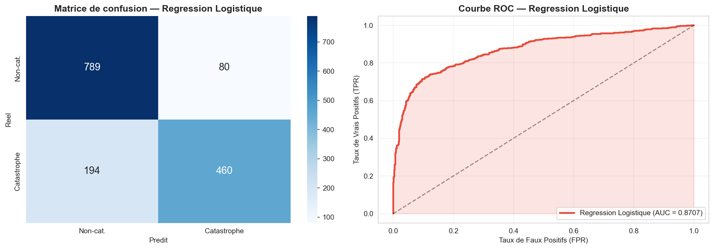

<a id="top"></a>

<p align="center">
  <a href="#fr">🇫🇷 Français</a> · <a href="#en">🇬🇧 English</a>
</p>

<a id="fr"></a>

# Eye of Emergency

**Un modèle de NLP qui trie automatiquement les tweets annonçant une vraie catastrophe et ceux qui emploient ces mots au sens figuré.**

<p align="center"><a href="#fr">🇫🇷 Français</a> · <a href="#en">🇬🇧 English</a></p>

---

## En bref

- **Problème** : pendant une catastrophe, les secours sont noyés sous les tweets, et « *my phone is on fire* » utilise le même vocabulaire que « *forest fire near the school* ». Il faut distinguer automatiquement les vrais signalements.
- **Données** : 7 613 tweets en anglais, étiquetés « vraie catastrophe » ou « non », plus 3 263 tweets sans étiquette pour les prédictions finales (jeu public Kaggle).
- **Méthode** : nettoyage du texte, transformation des mots en nombres, puis comparaison de 5 modèles d'apprentissage automatique (et d'un arbre de décision codé à la main), avec réglage automatique de leurs paramètres.
- **Résultat** : le modèle retenu, une régression logistique, classe correctement **82 % des tweets** qu'il n'a jamais vus. Quand il donne l'alerte, il a raison 85 fois sur 100.

---

## Sommaire

1. [Contexte et problématique](#contexte-et-problématique)
2. [Données](#données)
3. [Méthode](#méthode)
4. [Résultats](#résultats)
5. [Limites et pistes d'amélioration](#limites-et-pistes-damélioration)
6. [Structure du repo](#structure-du-repo)
7. [Installation et exécution](#installation-et-exécution)
8. [Équipe](#équipe)
9. [Stack technique](#stack-technique)

---

## Contexte et problématique

Lors d'un incendie, d'une inondation ou d'un séisme, les réseaux sociaux deviennent une source d'information en temps réel pour les services d'urgence, les médias et les ONG. Mais une grande partie des messages qui contiennent des mots comme *fire*, *flood* ou *explosion* ne parlent pas d'une vraie catastrophe (« *this song is fire* », « *I'm drowning in homework* »).

**Objectif** : construire un modèle qui, à partir du seul texte d'un tweet, prédit s'il décrit une catastrophe réelle (`target = 1`) ou non (`target = 0`).

**Cas d'usage** : pré-trier un flux de tweets pour qu'un opérateur humain se concentre sur les messages les plus susceptibles de signaler une urgence réelle.

La métrique optimisée est le **F1-score**, car les classes sont légèrement déséquilibrées (57 % / 43 %) et il faut équilibrer deux erreurs : rater une vraie catastrophe et déclencher une fausse alerte.

---

## Données

**Source** : jeu *Natural Language Processing with Disaster Tweets* ([Kaggle](https://www.kaggle.com/c/nlp-getting-started)), fourni dans `data/raw/`.

| Jeu | Fichier | Tweets | Colonnes |
|---|---|---|---|
| Entraînement | `train_tweets.csv` | 7 613 | `id`, `keyword`, `location`, `text`, `target` |
| Test | `test_tweets.csv` | 3 263 | `id`, `keyword`, `location`, `text` (sans `target`) |

**Principales variables**

| Colonne | Description |
|---|---|
| `text` | Contenu du tweet. C'est la seule variable utilisée par les modèles. |
| `keyword` | Mot-clé associé (ex. *earthquake*, *fire*), parfois vide. |
| `location` | Lieu déclaré par l'utilisateur, souvent vide. |
| `target` | Variable cible : `1` = vraie catastrophe, `0` = sinon. |

**Qualité des données** (sorties de `data_analysis.ipynb`)

| Constat | Entraînement | Test |
|---|---|---|
| `keyword` manquant | 61 (0,8 %) | 26 (0,8 %) |
| `location` manquant | 2 533 (33,3 %) | 1 105 (33,9 %) |
| Textes en doublon | 110 | 20 |
| Tweets présents dans les deux jeux | 68 | 68 |

**Répartition des classes** : 4 342 tweets non-catastrophe (57,0 %) et 3 271 tweets de catastrophe (43,0 %).

---

## Méthode

### 1. Exploration

- Les tweets font en moyenne 101 caractères et 14,9 mots. Les tweets de catastrophe sont un peu plus longs (108 caractères contre 96).
- Le vocabulaire des vraies catastrophes est factuel (lieux, bilans, événements : *derailment*, *typhoon*, *evacuated*). Les tweets non-catastrophe emploient souvent les mêmes mots-clés au sens figuré.
- Graphiques produits dans [`outputs/`](outputs/) : distribution des classes, longueur des tweets, nuages de mots, mots-clés par classe.

### 2. Nettoyage et prétraitement du texte

1. Suppression des URLs et des mentions `@utilisateur`. Pour les hashtags, on garde le mot et on retire le `#` (`#earthquake` → `earthquake`).
2. Suppression de la ponctuation et des nombres, passage en minuscules.
3. Tokenisation (NLTK).
4. Suppression des mots vides anglais (*stop-words*).
5. Lemmatisation (*killed*, *killing* → *kill*).
6. Vectorisation **TF-IDF** : 5 000 termes, mots seuls et paires de mots.

Après nettoyage, un tweet passe en moyenne de 14,9 à 8,8 mots (−41,2 %).

### 3. Modèles testés

Les données d'entraînement sont découpées en 6 090 tweets pour l'apprentissage et 1 523 pour la validation (découpage stratifié, `random_state=42`).

| Modèle | Famille |
|---|---|
| Régression logistique | Modèle linéaire |
| Arbre de décision | Arbre seul |
| Random Forest | *Bagging* : arbres entraînés en parallèle, puis vote |
| XGBoost | *Boosting* : arbres entraînés à la suite, chacun corrige le précédent |
| SVM | Séparateur à vaste marge |
| `CustomDecisionTree` | Arbre CART (critère de Gini) codé from scratch en Python |

Les hyperparamètres ont été optimisés par **GridSearchCV** (validation croisée en 3 plis, score F1). Trois variantes de prétraitement ont aussi été comparées : lemmatisation avec ou sans mots vides, et racinisation (*stemming*).

### 4. Choix final : régression logistique + TF-IDF

- **Meilleure performance** sur la validation, sur toutes les métriques sauf le rappel, où le SVM et la Random Forest font un peu mieux (voir le tableau ci-dessous).
- **Interprétable** : ses coefficients montrent directement quels mots font pencher vers « catastrophe ».
- **Rapide** à entraîner et à utiliser, donc compatible avec un flux de tweets en temps réel.

---

## Résultats

**En clair** : sur 1 523 tweets que le modèle n'avait jamais vus, il en classe correctement 1 249, soit **82 %**. Il repère 7 vraies catastrophes sur 10, et quand il signale une catastrophe, il a raison dans 85 % des cas.

### Comparaison des modèles (jeu de validation, `data_analysis.ipynb`)

| Modèle | Accuracy | Précision | Rappel | F1-score | ROC-AUC |
|---|---|---|---|---|---|
| **Régression logistique** | **0,8201** | **0,8519** | 0,7034 | **0,7705** | **0,8707** |
| SVM | 0,8096 | 0,8171 | 0,7171 | 0,7638 | 0,8603 |
| Random Forest | 0,7938 | 0,7843 | 0,7171 | 0,7492 | 0,8569 |
| XGBoost | 0,7859 | 0,7837 | 0,6927 | 0,7354 | 0,8505 |
| CustomDecisionTree* | 0,6267 | 0,8077 | 0,1641 | 0,2727 | 0,5675 |

\* L'arbre maison est entraîné et évalué sur un échantillon de 1 500 tweets (300 en validation), car il est lent en Python pur. Ses scores ne sont donc pas directement comparables aux autres. Sur ce même échantillon, l'arbre de scikit-learn avec les mêmes paramètres obtient 0,6133 d'accuracy et 0,2368 de F1.

L'arbre de décision de scikit-learn, testé avec ses paramètres de départ, obtient 0,6730 d'accuracy et 0,4209 de F1. Il n'a pas été repris dans le GridSearch.

**Matrice de confusion du modèle retenu** (1 523 tweets) : 789 vrais négatifs, 80 fausses alertes, 194 catastrophes manquées, 460 catastrophes détectées.



### Meilleurs hyperparamètres (GridSearchCV, 3 plis)

| Modèle | Meilleurs paramètres | F1 en validation croisée | F1 en validation |
|---|---|---|---|
| Régression logistique | `C=1.0`, `penalty='l2'`, `solver='liblinear'` | 0,7335 | 0,7705 |
| SVM | `C=1.0`, `kernel='linear'`, `gamma='scale'` | 0,7300 | 0,7638 |
| Random Forest | `n_estimators=100`, `max_depth=None`, `min_samples_split=5` | 0,7128 | 0,7492 |
| XGBoost | `n_estimators=200`, `max_depth=9`, `learning_rate=0.3` | 0,7088 | 0,7354 |

### Impact du prétraitement (régression logistique)

| Variante | Accuracy | F1-score | ROC-AUC |
|---|---|---|---|
| Lemmatisation, sans mots vides | 0,8207 | 0,7715 | 0,8707 |
| Lemmatisation, avec mots vides | 0,8214 | 0,7745 | 0,8682 |
| Racinisation, sans mots vides | 0,8181 | 0,7694 | 0,8703 |

Les trois variantes donnent des résultats très proches : moins de 0,6 point d'écart en F1.

### Analyse complémentaire (`analyse_modelisation_axel.ipynb`)

Une seconde modélisation, menée de façon indépendante, compare aussi *Bag of Words* et TF-IDF (3 000 termes, validation croisée en 5 plis) et intègre l'arbre maison au GridSearch. Elle aboutit à la même conclusion :

| Modèle | Accuracy | Précision | Rappel | F1-score |
|---|---|---|---|---|
| **Régression logistique + TF-IDF** | **0,818** | 0,834 | 0,720 | **0,773** |
| XGBoost | 0,812 | 0,826 | 0,713 | 0,765 |
| SVM linéaire | 0,806 | 0,808 | 0,720 | 0,762 |
| Random Forest | 0,793 | 0,778 | 0,723 | 0,750 |
| Arbre de décision (scikit-learn) | 0,729 | 0,675 | 0,714 | 0,694 |
| CustomDecisionTree (300 termes) | 0,684 | 0,862 | 0,315 | 0,461 |

Le modèle final, ré-entraîné sur les 7 613 tweets, prédit que 35,3 % des 3 263 tweets du jeu de test signalent une catastrophe. Les prédictions sont enregistrées dans [`data/processed/test_predictions.csv`](data/processed/test_predictions.csv).

---

## Limites et pistes d'amélioration

- **Catastrophes manquées** : environ 3 vraies catastrophes sur 10 ne sont pas détectées (rappel de 0,70). Le modèle doit rester une aide au tri, pas une décision automatique. Piste : abaisser le seuil de décision pour favoriser le rappel.
- **Doublons non traités** : 110 textes en doublon dans le jeu d'entraînement et 68 tweets communs aux deux jeux n'ont pas été retirés.
- **TF-IDF ignore l'ordre et le contexte des mots**, y compris la négation (*« no fire »*). Des embeddings (Word2Vec, FastText) ou un modèle de langage pré-entraîné (BERT, DistilBERT) pourraient faire mieux.
- **Variables annexes peu exploitées** : `keyword` et `location` ne sont pas utilisées par les modèles.
- **Une seule validation** : les scores viennent d'un seul découpage entraînement / validation. Aucun score obtenu sur le jeu de test (soumission Kaggle) ne figure dans le repo.

---

## Structure du repo

| Fichier / dossier | Rôle |
|---|---|
| [`data_analysis.ipynb`](data_analysis.ipynb) | Notebook principal : exploration, prétraitement, 5 modèles, GridSearch, évaluation. Il génère les graphiques de `outputs/`. |
| [`analyse_modelisation_axel.ipynb`](analyse_modelisation_axel.ipynb) | Analyse complète indépendante : veille, exploration, pipeline scikit-learn, comparaison BoW / TF-IDF, prédictions sur le jeu de test. |
| [`veille_nlp.ipynb`](veille_nlp.ipynb) | Veille théorique : Text Mining, NLP, stop-words, tokens, n-grammes, stemming, lemmatisation. |
| [`data/raw/`](data/raw/) | Données brutes (`train_tweets.csv`, `test_tweets.csv`). |
| [`data/processed/test_predictions.csv`](data/processed/test_predictions.csv) | Prédictions du modèle final sur les 3 263 tweets de test. |
| [`outputs/`](outputs/) | Graphiques (distributions, nuages de mots, matrices de confusion, comparaison des métriques). |
| [`docs/veille_technique_nlp.md`](docs/veille_technique_nlp.md) | Veille technique et sources. |
| [`docs/eda_texte_nlp.md`](docs/eda_texte_nlp.md) | Méthode d'exploration de données textuelles. |
| [`docs/suivi_de_projet.md`](docs/suivi_de_projet.md) | Journal de suivi du projet. |
| [`docs/consignes/`](docs/consignes/) | Ressources et support d'atelier fournis par l'école. |
| `requirements.txt` | Dépendances Python. |

---

## Installation et exécution

Prérequis : Python 3.10 ou plus récent.

```bash
git clone https://github.com/axel-achart/eye-of-emergency.git
cd eye-of-emergency

python -m venv .venv
# Windows : .venv\Scripts\activate
# macOS / Linux : source .venv/bin/activate

pip install -r requirements.txt
python -m nltk.downloader punkt punkt_tab stopwords wordnet omw-1.4

jupyter notebook data_analysis.ipynb
```

Les notebooks se lancent depuis la racine du repo, car les chemins `data/raw/...` et `outputs/...` sont relatifs. Les sorties sont déjà enregistrées dans les notebooks : vous pouvez lire les résultats sans rien relancer.

---

## Équipe

| Nom | GitHub |
|---|---|
| Axel Achart | [@axel-achart](https://github.com/axel-achart) |
| Hippolyte Geslain | [@Hippolyte-Geslain](https://github.com/Hippolyte-Geslain) |
| Kylliann Larcher | [@kylliann-larcher](https://github.com/kylliann-larcher) |

Projet d'équipe réalisé à [LaPlateforme_](https://laplateforme.io) (Marseille), Bachelor IA/Data, du 29 juillet au 4 août 2026.

---

## Stack technique

- **Langage** : Python
- **Données** : pandas, NumPy
- **NLP** : NLTK (tokenisation, stop-words, lemmatisation), TF-IDF / Bag of Words (scikit-learn)
- **Modélisation** : scikit-learn (régression logistique, arbre de décision, Random Forest, SVM, GridSearchCV, Pipeline), XGBoost
- **Visualisation** : Matplotlib, Seaborn, WordCloud
- **Environnement** : Jupyter Notebook, Git / GitHub

<p align="right"><a href="#top">↑ Haut de page</a></p>

---
---

<a id="en"></a>

# Eye of Emergency

**An NLP model that automatically separates tweets reporting a real disaster from tweets that use the same words figuratively.**

<p align="center"><a href="#fr">🇫🇷 Français</a> · <a href="#en">🇬🇧 English</a></p>

---

## At a glance

- **Problem**: during a disaster, emergency services are flooded with tweets, and "*my phone is on fire*" uses the same words as "*forest fire near the school*". Real reports have to be picked out automatically.
- **Data**: 7,613 English tweets labelled "real disaster" or "not", plus 3,263 unlabelled tweets for the final predictions (public Kaggle dataset).
- **Method**: text cleaning, turning words into numbers, then a comparison of 5 machine learning models (plus a decision tree coded by hand), with automatic tuning of their settings.
- **Result**: the selected model, a logistic regression, correctly classifies **82% of tweets** it has never seen. When it raises an alert, it is right 85 times out of 100.

---

## Contents

1. [Context and problem](#context-and-problem)
2. [Data](#data)
3. [Method](#method)
4. [Results](#results)
5. [Limitations and next steps](#limitations-and-next-steps)
6. [Repository structure](#repository-structure)
7. [Installation and usage](#installation-and-usage)
8. [Team](#team)
9. [Tech stack](#tech-stack)

---

## Context and problem

During a wildfire, a flood or an earthquake, social media becomes a real-time source of information for emergency services, the media and NGOs. But many messages containing words such as *fire*, *flood* or *explosion* are not about a real disaster ("*this song is fire*", "*I'm drowning in homework*").

**Goal**: build a model that predicts, from the text of a tweet alone, whether it describes a real disaster (`target = 1`) or not (`target = 0`).

**Use case**: pre-sort a stream of tweets so that a human operator can focus on the messages most likely to report a real emergency.

The optimized metric is the **F1-score**, because the classes are slightly imbalanced (57% / 43%) and two errors have to be balanced: missing a real disaster and raising a false alarm.

---

## Data

**Source**: *Natural Language Processing with Disaster Tweets* dataset ([Kaggle](https://www.kaggle.com/c/nlp-getting-started)), included in `data/raw/`.

| Set | File | Tweets | Columns |
|---|---|---|---|
| Training | `train_tweets.csv` | 7,613 | `id`, `keyword`, `location`, `text`, `target` |
| Test | `test_tweets.csv` | 3,263 | `id`, `keyword`, `location`, `text` (no `target`) |

**Main variables**

| Column | Description |
|---|---|
| `text` | Tweet content. This is the only variable used by the models. |
| `keyword` | Associated keyword (e.g. *earthquake*, *fire*), sometimes empty. |
| `location` | Location given by the user, often empty. |
| `target` | Target: `1` = real disaster, `0` = not. |

**Data quality** (outputs of `data_analysis.ipynb`)

| Finding | Training | Test |
|---|---|---|
| Missing `keyword` | 61 (0.8%) | 26 (0.8%) |
| Missing `location` | 2,533 (33.3%) | 1,105 (33.9%) |
| Duplicate texts | 110 | 20 |
| Tweets found in both sets | 68 | 68 |

**Class balance**: 4,342 non-disaster tweets (57.0%) and 3,271 disaster tweets (43.0%).

---

## Method

### 1. Exploration

- Tweets average 101 characters and 14.9 words. Disaster tweets are slightly longer (108 characters vs 96).
- Real-disaster vocabulary is factual (places, casualties, events: *derailment*, *typhoon*, *evacuated*). Non-disaster tweets often use the same keywords figuratively.
- Charts saved in [`outputs/`](outputs/): class distribution, tweet length, word clouds, keywords by class.

### 2. Text cleaning and preprocessing

1. Remove URLs and `@user` mentions. For hashtags, keep the word and drop the `#` (`#earthquake` → `earthquake`).
2. Remove punctuation and numbers, convert to lowercase.
3. Tokenization (NLTK).
4. Remove English stop-words.
5. Lemmatization (*killed*, *killing* → *kill*).
6. **TF-IDF** vectorization: 5,000 terms, single words and word pairs.

After cleaning, a tweet goes from 14.9 to 8.8 words on average (−41.2%).

### 3. Models tested

The training data is split into 6,090 tweets for learning and 1,523 for validation (stratified split, `random_state=42`).

| Model | Family |
|---|---|
| Logistic regression | Linear model |
| Decision tree | Single tree |
| Random Forest | *Bagging*: trees trained in parallel, then a vote |
| XGBoost | *Boosting*: trees trained one after another, each fixing the previous one |
| SVM | Support vector machine |
| `CustomDecisionTree` | CART tree (Gini criterion) coded from scratch in Python |

Hyperparameters were tuned with **GridSearchCV** (3-fold cross-validation, F1 scoring). Three preprocessing variants were also compared: lemmatization with or without stop-words, and stemming.

### 4. Final choice: logistic regression + TF-IDF

- **Best performance** on validation, on every metric except recall, where SVM and Random Forest do slightly better (see the table below).
- **Interpretable**: its coefficients show directly which words push a tweet towards "disaster".
- **Fast** to train and to use, so it fits a real-time tweet stream.

---

## Results

**In plain words**: out of 1,523 tweets the model had never seen, it correctly classifies 1,249, which is **82%**. It catches 7 real disasters out of 10, and when it flags a disaster, it is right 85% of the time.

### Model comparison (validation set, `data_analysis.ipynb`)

| Model | Accuracy | Precision | Recall | F1-score | ROC-AUC |
|---|---|---|---|---|---|
| **Logistic regression** | **0.8201** | **0.8519** | 0.7034 | **0.7705** | **0.8707** |
| SVM | 0.8096 | 0.8171 | 0.7171 | 0.7638 | 0.8603 |
| Random Forest | 0.7938 | 0.7843 | 0.7171 | 0.7492 | 0.8569 |
| XGBoost | 0.7859 | 0.7837 | 0.6927 | 0.7354 | 0.8505 |
| CustomDecisionTree* | 0.6267 | 0.8077 | 0.1641 | 0.2727 | 0.5675 |

\* The hand-coded tree is trained and evaluated on a 1,500-tweet sample (300 for validation), because it is slow in pure Python. Its scores are therefore not directly comparable with the others. On the same sample, scikit-learn's tree with the same parameters gets 0.6133 accuracy and 0.2368 F1.

scikit-learn's decision tree, tested with its starting parameters, gets 0.6730 accuracy and 0.4209 F1. It was not included in the GridSearch.

**Confusion matrix of the selected model** (1,523 tweets): 789 true negatives, 80 false alarms, 194 missed disasters, 460 detected disasters.


### Best hyperparameters (GridSearchCV, 3 folds)

| Model | Best parameters | Cross-validation F1 | Validation F1 |
|---|---|---|---|
| Logistic regression | `C=1.0`, `penalty='l2'`, `solver='liblinear'` | 0.7335 | 0.7705 |
| SVM | `C=1.0`, `kernel='linear'`, `gamma='scale'` | 0.7300 | 0.7638 |
| Random Forest | `n_estimators=100`, `max_depth=None`, `min_samples_split=5` | 0.7128 | 0.7492 |
| XGBoost | `n_estimators=200`, `max_depth=9`, `learning_rate=0.3` | 0.7088 | 0.7354 |

### Preprocessing impact (logistic regression)

| Variant | Accuracy | F1-score | ROC-AUC |
|---|---|---|---|
| Lemmatization, no stop-words | 0.8207 | 0.7715 | 0.8707 |
| Lemmatization, with stop-words | 0.8214 | 0.7745 | 0.8682 |
| Stemming, no stop-words | 0.8181 | 0.7694 | 0.8703 |

The three variants give very close results: less than 0.6 points apart in F1.

### Complementary analysis (`analyse_modelisation_axel.ipynb`)

A second, independent modelling also compares *Bag of Words* and TF-IDF (3,000 terms, 5-fold cross-validation) and includes the hand-coded tree in the GridSearch. It reaches the same conclusion:

| Model | Accuracy | Precision | Recall | F1-score |
|---|---|---|---|---|
| **Logistic regression + TF-IDF** | **0.818** | 0.834 | 0.720 | **0.773** |
| XGBoost | 0.812 | 0.826 | 0.713 | 0.765 |
| Linear SVM | 0.806 | 0.808 | 0.720 | 0.762 |
| Random Forest | 0.793 | 0.778 | 0.723 | 0.750 |
| Decision tree (scikit-learn) | 0.729 | 0.675 | 0.714 | 0.694 |
| CustomDecisionTree (300 terms) | 0.684 | 0.862 | 0.315 | 0.461 |

The final model, retrained on all 7,613 tweets, predicts that 35.3% of the 3,263 test tweets report a disaster. The predictions are saved in [`data/processed/test_predictions.csv`](data/processed/test_predictions.csv).

---

## Limitations and next steps

- **Missed disasters**: about 3 real disasters out of 10 are not detected (recall of 0.70). The model should remain a sorting aid, not an automatic decision. Next step: lower the decision threshold to favour recall.
- **Duplicates not handled**: 110 duplicate texts in the training set and 68 tweets shared by both sets were not removed.
- **TF-IDF ignores word order and context**, including negation (*"no fire"*). Embeddings (Word2Vec, FastText) or a pre-trained language model (BERT, DistilBERT) could do better.
- **Side variables barely used**: `keyword` and `location` are not used by the models.
- **Single validation split**: the scores come from a single train / validation split. No test-set score (Kaggle submission) is included in the repository.

---

## Repository structure

| File / folder | Role |
|---|---|
| [`data_analysis.ipynb`](data_analysis.ipynb) | Main notebook: exploration, preprocessing, 5 models, GridSearch, evaluation. It generates the charts in `outputs/`. |
| [`analyse_modelisation_axel.ipynb`](analyse_modelisation_axel.ipynb) | Independent full analysis: literature review, exploration, scikit-learn pipeline, BoW / TF-IDF comparison, test-set predictions. |
| [`veille_nlp.ipynb`](veille_nlp.ipynb) | Literature review: Text Mining, NLP, stop-words, tokens, n-grams, stemming, lemmatization. |
| [`data/raw/`](data/raw/) | Raw data (`train_tweets.csv`, `test_tweets.csv`). |
| [`data/processed/test_predictions.csv`](data/processed/test_predictions.csv) | Final model predictions for the 3,263 test tweets. |
| [`outputs/`](outputs/) | Charts (distributions, word clouds, confusion matrices, metric comparison). |
| [`docs/veille_technique_nlp.md`](docs/veille_technique_nlp.md) | Technical research notes and sources (in French). |
| [`docs/eda_texte_nlp.md`](docs/eda_texte_nlp.md) | Text data exploration method (in French). |
| [`docs/suivi_de_projet.md`](docs/suivi_de_projet.md) | Project log (in French). |
| [`docs/consignes/`](docs/consignes/) | Resources and workshop material provided by the school. |
| `requirements.txt` | Python dependencies. |

---

## Installation and usage

Requirement: Python 3.10 or later.

```bash
git clone https://github.com/axel-achart/eye-of-emergency.git
cd eye-of-emergency

python -m venv .venv
# Windows: .venv\Scripts\activate
# macOS / Linux: source .venv/bin/activate

pip install -r requirements.txt
python -m nltk.downloader punkt punkt_tab stopwords wordnet omw-1.4

jupyter notebook data_analysis.ipynb
```

Run the notebooks from the repository root, because the `data/raw/...` and `outputs/...` paths are relative. The outputs are already saved in the notebooks: you can read the results without running anything.

---

## Team

| Name | GitHub |
|---|---|
| Axel Achart | [@axel-achart](https://github.com/axel-achart) |
| Hippolyte Geslain | [@Hippolyte-Geslain](https://github.com/Hippolyte-Geslain) |
| Kylliann Larcher | [@kylliann-larcher](https://github.com/kylliann-larcher) |

Team project carried out at [LaPlateforme_](https://laplateforme.io) (Marseille), Bachelor in AI/Data, from July 29 to August 4, 2026.

---

## Tech stack

- **Language**: Python
- **Data**: pandas, NumPy
- **NLP**: NLTK (tokenization, stop-words, lemmatization), TF-IDF / Bag of Words (scikit-learn)
- **Modelling**: scikit-learn (logistic regression, decision tree, Random Forest, SVM, GridSearchCV, Pipeline), XGBoost
- **Visualization**: Matplotlib, Seaborn, WordCloud
- **Environment**: Jupyter Notebook, Git / GitHub

<p align="right"><a href="#top">↑ Back to top</a></p>
